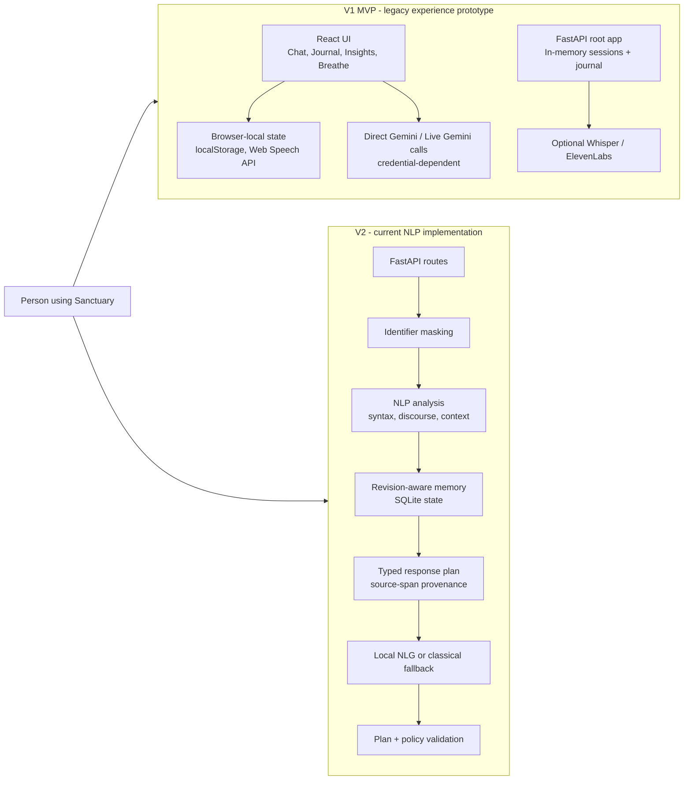
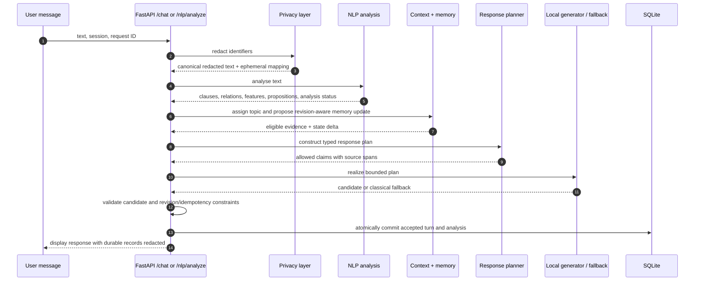
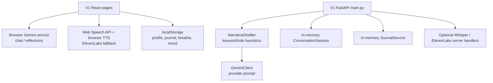
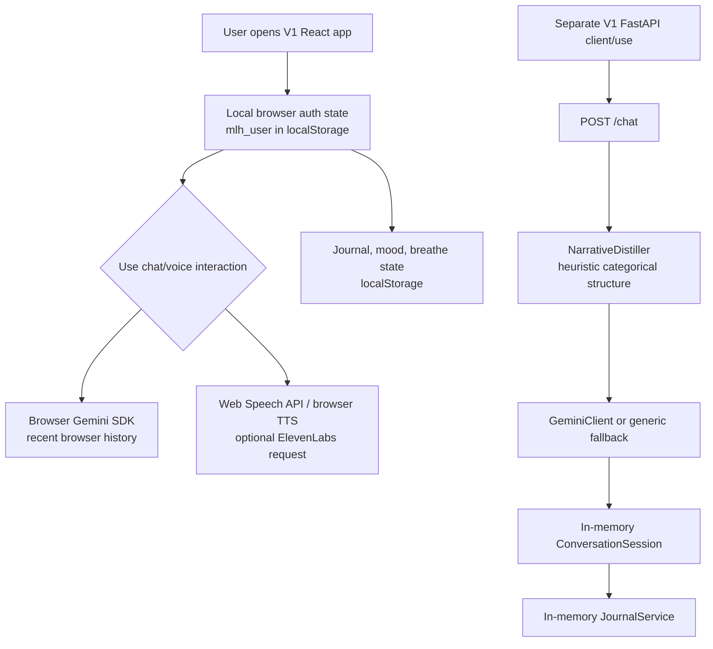
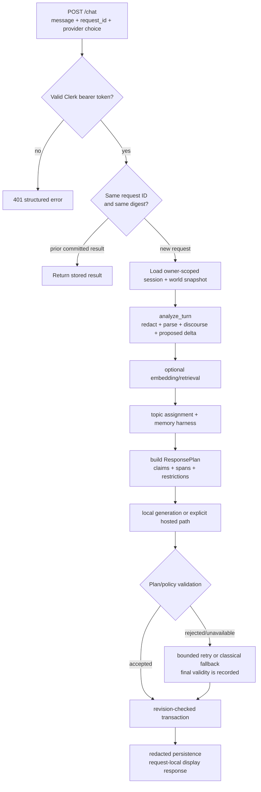

# Sanctuary Workspace

Sanctuary is a privacy-aware reflective-conversation workspace containing two materially different implementations:

- **V1 MVP** is the original experience-oriented prototype: React pages, browser-side Gemini/voice integrations, a lightweight FastAPI backend, in-memory sessions, and local browser storage.
- **V2** is the current NLP systems implementation: a FastAPI/SQLite backend with identifier masking, structured linguistic and discourse analysis, revision-aware context, response planning, constrained local generation, and explicit evaluation artifacts.

This README is the workspace source of truth. It distinguishes what is implemented from what is conditional on credentials/models, what is experimental, and what is deliberately deferred. It must not be read as evidence of therapeutic efficacy, diagnosis, clinical safety, semantic accuracy, or privacy guarantees.

## Status Legend

| Label | Meaning |
|---|---|
| **Working in code** | The feature is invoked on the described code path and has a defined output/state transition. |
| **Conditional** | The code is wired, but requires local models, resources, credentials, an external provider, or environment configuration. |
| **Experimental / diagnostic** | The code produces analysis, a comparison, or a prototype result but is not an authority for production response content. |
| **Deferred** | Intentionally excluded from the current deliverable; the reason is stated in the deferral register. |
| **Not established** | The repository does not contain sufficient evidence to make a quality, security, scientific, or deployment claim. |

---

## 0) Full Workspace Architecture Pack

### 0.1 Version Context



### 0.2 V2 Canonical NLP Flow



### 0.3 V1 Versus V2 at a Glance

| Dimension | V1 MVP | V2 |
|---|---|---|
| Primary purpose | Experience prototype for chat, voice, journaling, breathing, and dashboard interactions. | Evidence-linked NLP system for privacy-aware narrative structuring in reflective conversations. |
| Conversation logic | Prompt-led Gemini responses plus a heuristic `NarrativeStructure` distiller. | Redaction, linguistic/discourse analysis, contextual state, response planning, bounded generation, validation. |
| Persistence | Backend sessions/journal are in memory; browser features use `localStorage`. | SQLite-backed sessions, turns, analyses, journal records, and user-scoped memory state. |
| Privacy model | Intended abstraction in backend narrative structure; browser-direct Gemini path can send user text to a provider. | Canonical redacted representation, redacted persistence/provider boundaries, explicit optional local-raw settings. |
| Context / corrections | Last few in-memory turns; no revision-aware assertion model. | Topic assignment, provenance-linked assertions, correction/supersession handling, unresolved conflicts. |
| Generation | Gemini is the central response authority; generic fallback if unavailable. | Response plan owns permitted claims; local model/classical realizer only phrases that plan. |
| Evaluation | Unit-test folder exists, but no current evidence package establishes end-to-end V1 quality. | Synthetic multi-turn execution artifacts, traceability checks, failure audit, and focused tests. |
| Release position | **Legacy / reference implementation.** Not a reproducible production package in its current workspace form. | **Current implementation candidate.** Backend core is reportable; semantic-quality and release claims remain bounded. |

---

## 1) Repository Structure

```text
MLH_PROMPT_TRAIN_PARTY/
  V1_MVP/                         # Legacy product-first prototype
    main.py                        # Canonical legacy FastAPI entry point
    backend/                       # V1 models, services, configuration, API remnants
    frontend/                      # React/Vite prototype UI and browser integrations
    LandingpgV1/                   # Additional legacy landing-page material
    tests/                         # Small V1 test set
    Dockerfile, docker-compose.yml # Legacy packaging intent; see known limitations

  V2/                              # Current NLP systems implementation
    backend/
      app/api/                     # FastAPI routes, error/body/policy middleware
      app/services/                # Privacy, NLP, memory, response, local-NLG modules
      tests/                       # Backend unit/integration/contract tests
      evaluation/                  # Synthetic execution and audit artifacts
      scripts/                     # Setup, demos, evaluators, browser checks
      requirements-nlp.lock        # Direct dependency/version lock
    frontend/                       # React/Vite UI for V2 APIs and analysis views
    NLP_CORE.md                    # Detailed integrated NLP component boundaries
    SANCTUARY_DATASET_EVALUATION_REPORT.md
    RESEARCH_COMPONENT_IMPACT_DECISION.md
    BACKEND_NLP_IMPLEMENTATION_REPORT.md

  sanctuary_v2/                    # Separate architecture-stage V2 scaffold
    backend/                        # Async SQLAlchemy/auth/provider abstraction prototype
    models/dmrst_parser/            # Vendored research/parser material

  V1_MVP/, V2/, and sanctuary_v2/ have separate implementation histories.
  Do not merge their dependency, storage, or runtime assumptions.
```

---

## 2) V1 MVP: Legacy Experience Prototype

### 2.1 Intended Runtime Flow



### 2.2 What Is Implemented in V1

| Area | Status | What the code does | Boundary |
|---|---|---|---|
| React routes and product pages | **Working in code** | Includes Landing, Auth, Dashboard, Chat, Journal, Insights, Breathe, Profile, Resources, Settings, and Emergency pages. | Browser behavior has not been re-audited as part of the V2 NLP validation work. |
| Browser-local profile/journal/mood/breathing state | **Working in code** | Uses `localStorage` keys such as `mlh_user`, `mlh_journal`, and `mlh_breathe_stats`. | This is device/browser-local state, not durable multi-user persistence or access control. |
| Browser direct Gemini chat/reflection | **Conditional** | `frontend/src/services/gemini.js` sends chat/reflection prompts through a Gemini SDK when `VITE_GEMINI_API_KEY` is configured. | User text is handled by a provider-facing browser integration; it is not the V2 redacted pipeline. Client-exposed provider credentials are unsuitable for a public production deployment. |
| Browser voice interaction | **Conditional** | Uses Web Speech API recognition, browser speech synthesis, and optional ElevenLabs calls. | Support depends on browser capabilities and API credentials. It is not a tested server-side speech pipeline. |
| V1 FastAPI chat API | **Working in code, conditional to run** | `/chat` creates/reuses an in-memory session, invokes `NarrativeDistiller`, builds a Gemini prompt, returns Gemini output or a generic fallback. | Requires a rebuilt dependency environment and provider configuration; state is lost on restart. |
| V1 heuristic narrative distiller | **Working in code** | Derives an 11-field categorical structure using phrase/keyword heuristics: trigger, reaction, valence, arousal, agency, temporal clarity, causal links, resolution, phase. | These are heuristic labels, not clinically validated assessments or model predictions. |
| V1 journal API | **Working in code** | Suggests moments with keyword/rule scores and creates, reads, or deletes in-memory entries. | Entries disappear after process restart; there is no user ownership or durable database boundary. |
| V1 voice API | **Conditional** | Server endpoints support upload/transcription and synthesis through optional clients. | Depends on provider keys/libraries; repository evidence does not establish a successful end-to-end voice run. |
| Docker deployment files | **Not currently reproducible** | Docker files express an intended backend container. | They reference a root `requirements.txt` that is absent from the current workspace, so this V1 package cannot be represented as deployment-ready. |

### 2.3 V1 API Surface

The legacy root app in `V1_MVP/main.py` defines:

| Endpoint | Purpose | State boundary |
|---|---|---|
| `GET /`, `GET /health` | Service and provider-health information. | Health is provider-dependent. |
| `POST /chat` | Distill a message, prompt Gemini, save the turn in memory. | In-memory session only. |
| `POST /voice/transcribe` | Upload audio for optional transcription. | Temporary file + provider/library dependent. |
| `POST /voice/synthesize` | Convert response text to optional audio. | Provider/library dependent. |
| `GET /conversation/{session_id}` | Read in-memory conversation turns. | No durable ownership model. |
| `POST /journal/suggest` | Heuristically suggest conversation moments. | Rule score, not a learned importance model. |
| `POST /journal/create`, `GET/DELETE /journal/{entry_id}` | Manage in-memory journal entries. | Lost on restart. |

### 2.4 V1 User Journey and Its Split Runtime

V1 does not have one single end-to-end path. Its React client can use
browser-direct provider integrations and browser-local storage, while
`V1_MVP/main.py` exposes a distinct FastAPI prototype. This is the key reason
V1 is documented as a legacy experience prototype rather than a unified,
privacy-bounded deployment.



| Step | Browser-first V1 path | Backend-first V1 path | Consequence |
|---|---|---|---|
| Identity | Reads/writes a browser-local `mlh_user` record. | Accepts a supplied session ID; no durable user ownership database. | Neither is the V2 authenticated owner-scoped model. |
| Chat | Gemini SDK receives recent chat history directly in the browser. | `/chat` adds a turn, distills a heuristic structure, prompts Gemini, then stores turns in memory. | These are different paths with different privacy and persistence boundaries. |
| Voice | Web Speech API recognition and browser TTS, with optional direct ElevenLabs call. | Optional transcribe/synthesize endpoints use configured service clients. | Capability is configuration/browser dependent, not an established end-to-end voice service. |
| Journal | Pages store journal/breathe/mood data in browser `localStorage`. | Journal API creates in-memory entries from selected turns. | Both forms of data vanish outside their respective browser/process scope. |

This split is intentional historical context, not a defect to silently hide. It
explains why V2 was built as a server-owned, evidence-linked NLP path rather
than by incrementally adding algorithms to V1.

### 2.5 Why V1 Is Not the Current NLP Submission

V1 was a useful product prototype, but it does not offer the evidence boundary required for the current NLP project:

- The primary frontend chat path can call Gemini directly, bypassing the backend distiller and any server-side privacy boundary.
- The backend sends a prompt built from a heuristic narrative structure, but Gemini remains responsible for response content.
- Sessions and journal records are in memory; frontend records are browser-local. There is no durable revision history or user-scoped database model.
- Its narrative labels include emotional valence, arousal, and agency categories that must not be presented as validated psychological inference.
- The current workspace lacks the V1 dependency manifest expected by its Docker file, so reproducible packaging is incomplete.

V1 should therefore be kept as a **legacy UX/reference implementation**, not expanded or used as the basis for NLP-quality claims.

### 2.6 `sanctuary_v2`: Parallel Architecture Scaffold

`sanctuary_v2/` is not the canonical `V2/` runtime. It is a separate architecture-stage backend that contains async SQLAlchemy models, auth/session/turn routers, a placeholder-based privacy distiller, a personal-world-model design, provider abstractions, and an Alembic migration.

| Area | Status | Why it is not the canonical implementation |
|---|---|---|
| Auth, session, and turn API shape | **Working in code / conditional to run** | It exposes a separate `/auth`, `/session`, and `/turn` API contract, distinct from `V2/backend/main.py`. |
| Placeholder distillation and restoration | **Working in code** | It is an earlier/parallel privacy architecture, not the source used by the current V2 response-plan and evaluation pipeline. |
| Provider abstraction and PWM schema | **Architecture scaffold** | It establishes interfaces and persistence intent, but does not supply the evaluated NLP vertical slice in `V2/`. |
| Coreference Phase 2 work | **Deferred in this branch** | Its own code labels semantic/structural coreference work as Phase 2+; V2 has a different, conservative analysis/memory implementation. |

Keep this folder as design provenance or a future migration reference. Do not combine its API, database, or provider assumptions with `V2/` without an explicit migration plan and fresh tests.

---

## 3) V2: Current NLP Systems Implementation

### 3.1 Design Principle

V2 treats the language model as a **realizer**, not the owner of narrative truth. The system first derives bounded, inspectable evidence; only then does it ask a local generator or deterministic fallback to phrase a concise reflection.

### 3.2 Canonical Backend Components

| Component | Status | Responsibility | Practical effect |
|---|---|---|---|
| `app/services/privacy.py` | **Working in code** | Masks direct identifiers and recognised entities with stable placeholders. | Creates a redacted representation for analysis, persistence, and provider boundaries. |
| `app/services/nlp_engine.py` | **Working in code** | Pure text analysis: parsing, clauses, explicit relations, hedges, lexical features, correction cues, topic features, descriptive filtering. | Produces inspectable analysis without writing a DB row or calling a generator. |
| `app/services/classical_nlp.py` | **Conditional** | Simplified Lesk WSD, Hobbs-style antecedent proposals, Centering traces. | Supplies lexical/reference diagnostics; uncertain references remain unresolved. |
| `app/services/dmrst.py` | **Conditional** | Isolated CPU discourse parsing with a pretrained resource. | Returns RST/EDU analysis or an explicit unavailable/error state. It is not an accuracy claim. |
| `app/services/semantic_topics.py` | **Conditional** | Uses a compatible 384-dimensional MiniLM embedding to join/create semantic topics; has a hashed lexical fallback. | Can change a normal strategy to recurring-topic when prior semantic evidence exists. |
| `app/services/memory_harness.py` | **Working in code** | Creates provenance-linked assertions, corrections, conflicts, unresolved review items, and retrieval eligibility. | Keeps superseded assertions from being intentionally selected as active context. |
| `app/services/response_planner.py` | **Working in code** | Builds a schema-validated plan with strategy, claims, spans, revision context, and restrictions. | Separates permitted content from generated surface wording. |
| `app/services/local_generation.py` | **Conditional** | Loads a local Llama-based generator when available, attempts bounded generation/polish, and records diagnostics. | Uses the response plan rather than unrestricted raw conversation context. |
| Classical realizer | **Working in code** | Creates deterministic plan-based wording when generation cannot be used. | Maintains a no-provider fallback, though remaining validity failures are documented below. |
| `app/services/nlp_service.py` | **Working in code** | Coordinates preview/chat, enrichment, generation, idempotency, revisions, and transactions. | Owns runtime behavior and SQLite persistence. |

### 3.3 Detailed V2 NLP Flow

#### Stage A --- Privacy-preserving input preparation

The engine identifies emails, phone numbers, URLs, dates, handles, and selected named entities. It substitutes placeholders such as entity tokens and retains only a short-lived mapping for display restoration. Persisted analysis and default provider-facing content use the canonical redacted representation.

**Why this exists:** the project needs consistent entity references for coherence analysis without treating the stored text as a raw personal-data ledger.

**Boundary:** this is an engineering privacy control, not a formal anonymity, security, or regulatory-compliance guarantee.

#### Stage B --- Linguistic and discourse analysis

V2 uses spaCy for sentence segmentation, lemma/POS/dependency information, then derives:

- clause spans;
- explicit connective relations (`because`, `but`, `although`, `therefore`, etc.) under dependency/POS constraints;
- hedge spans such as `maybe`, `perhaps`, and `I think`;
- entity continuity, connective density, hedge density, and topic novelty;
- a conservative strategy candidate: closure, insufficient content, correction, contrast, recurring, explanation, or standard.

Ambiguous `since` is deliberately rejected rather than being guessed as causal or temporal. If the parser model is unavailable, the code returns a labelled sentence-level fallback instead of silently claiming full dependency analysis.

**Why this exists:** a response can say “you are holding two things together” only when contrast is explicitly present, or reflect a stated explanation only when it exists in the user text. This limits unsupported interpretation.

#### Stage C --- Classical analysis and optional pretrained analysis

The analysis path also invokes or records status for:

- **Simplified Lesk/WordNet:** lexical gloss-overlap sense candidates;
- **Hobbs-style reference proposals:** constituency traversal with conservative number/person/known-gender constraints when Benepar is available;
- **Centering:** sentence-level focus/transition traces;
- **DMRST:** pretrained discourse parsing in an isolated CPU worker;
- **restricted proposition frames:** predicate, surface roles, polarity, modality, scope, and potential supersession links.

These algorithms are genuinely wired into `analyze_turn()`. However, they are supporting analyses, not proof that V2 has solved word-sense disambiguation, coreference, or rhetorical parsing. Missing models/resources are represented as unavailable; they are not replaced with fabricated output.

#### Stage D --- Context, topics, and revision-aware memory

For a live compatible MiniLM embedding, V2 calculates cosine similarity against topic centroids and recent exemplars. It joins the best topic only above a configurable threshold (default `0.45`); otherwise it creates a topic. If embedding is unavailable or incompatible, the system explicitly falls back to the hashed term-frequency topic path.

The memory harness converts clause-level proposition frames into assertions with source-turn/source-span provenance. An explicit correction can supersede an active assertion only when shared evidence scope is sufficiently unambiguous. Conflicting or ambiguous cases are retained as unresolved items rather than overwritten.

**Why this exists:** it gives the response planner a controlled way to recognise recurring context and avoid reviving known superseded framing.

#### Stage E --- Response planning, realization, and validation

The planner selects current-turn claims and eligible historical evidence, writes a typed `ResponsePlan`, and verifies its schema. The plan records source spans, strategy, revision context, and content restrictions. Local generation receives the bounded plan. A response must pass plan/policy checks before acceptance; a classical plan realizer is available as fallback.

**Why this exists:** natural-language generation is separated from narrative-state decisions. A model should not decide that a person feels something or infer a cause merely because it can phrase a fluent sentence.

#### Stage F --- Persistence and API boundaries

The chat path performs idempotency checks, revision checks, and a short transaction before committing the turn, analysis, and proposed state. A stale revision returns a conflict rather than silently overwriting later state. Preview analysis follows the analytical path without committing a conversation turn.

### 3.4 V2 API Families

| API family | Examples | Status and purpose |
|---|---|---|
| Service/status | `GET /`, `GET /health`, `GET /auth/me` | **Working in code.** Reports service/runtime status; auth requires configured Clerk verification outside local test arrangements. |
| Conversation | `POST /chat`, `GET /sessions`, `GET /sessions/{id}/turns`, `DELETE /sessions/{id}` | **Working in code.** Core persisted chat/session lifecycle with ownership checks. |
| Analysis | `POST /nlp/analyze`, `POST /nlp/experiments`, turn classification routes | **Working in code.** Preview canonical analysis; experiments are explicitly non-authoritative. |
| Memory/privacy | `/nlp/memory`, `/nlp/memory/search`, `/nlp/memory/graph`, preferences, backfill, deletion | **Working in code / conditional for neural resources.** Evidence views, local-memory settings, and deletion operations. |
| Journal | Suggest/create/read/update/delete plus calendar routes | **Working in code.** Persisted user-scoped records, with redaction applied to calendar title/text before storage. |
| Emergency resources | `GET /resources/emergency` | **Working in code.** Static resource list; it is not a crisis intervention service. |

### 3.5 Backend Tree and Dependency Boundaries

The V2 backend is intentionally layered. The tree below describes what the
source tree does; it is not a claim that every optional model is installed or
available in every environment.

```text
V2/backend/
  main.py
  ├─ loads local environment configuration
  ├─ creates FastAPI application and database tables
  ├─ installs CORS, request-body, and policy-context middleware
  └─ mounts app/api/routes.py

  app/api/
  ├─ routes.py                 # HTTP contract and authenticated entrypoints
  ├─ middleware.py             # request/policy context handling
  ├─ body_limit.py             # streamed request-size boundary
  └─ error_contract.py         # structured error payload helpers

  app/models/
  ├─ schemas.py                # validated request/response structures
  ├─ db.py                     # SQLAlchemy engine/session/table setup
  └─ orm.py                    # durable session, turn, analysis, memory, journal rows

  app/services/
  ├─ nlp_service.py            # orchestration, idempotency, transactions, commit
  ├─ nlp_engine.py             # pure canonical text analysis
  ├─ privacy.py                # identifier stripping/restoration helpers
  ├─ classical_nlp.py          # Lesk, Hobbs, Centering traces
  ├─ discourse_context.py      # restricted proposition/context structures
  ├─ dmrst.py                  # optional pretrained discourse-parser adapter
  ├─ semantic_topics.py        # embedding-led topic continuity with fallback
  ├─ pwm.py                    # scenes/entities/threads from analysis
  ├─ memory_harness.py         # assertion, revision, conflict, retrieval eligibility
  ├─ memory_tools.py           # deterministic scene retrieval and graph export
  ├─ neural_memory.py          # optional embedding/NLI persistence and background work
  ├─ neural_runtime.py          # local neural resource lifecycle/status
  ├─ response_planner.py       # permitted claims and response-plan contract
  ├─ response_policy.py        # structural/tone/language policy checks
  ├─ local_generation.py       # local model realization and bounded attempts
  ├─ hosted_generation.py      # explicit-consent hosted option only
  ├─ journal_service.py        # journal selection, summaries, CRUD
  ├─ mathematical_models.py    # descriptive state/model diagnostics
  ├─ narrative_engine.py       # six-part NarrativeStructure distillation
  └─ algorithm_lab.py          # read-only algorithm comparisons

  tests/                       # unit, contract, state, evaluation, and integration tests
  evaluation/                  # synthetic-run records and audit artifacts
  scripts/                     # setup, evaluator, demo, and browser-check utilities
```

#### Why these layers are separate

| Layer | It receives | It produces | Why the boundary matters |
|---|---|---|---|
| HTTP/API | Authenticated request data. | Validated call to a service method or a structured error. | Routes should not embed NLP logic or make persistence decisions. |
| Schema/model | Request fields and database values. | Type/length-constrained payloads and ORM rows. | A 2,000-character chat limit, UUID request ID, and constrained preference payloads make the contract inspectable. |
| Pure analysis | Current text plus a copied state snapshot. | Redacted text, linguistic evidence, strategy cues, proposed state delta. | The analyzer does not directly write a database row or invoke a hosted model. This isolates analysis from side effects. |
| Context/memory | Proposed analysis and prior permitted state. | Topic decision, assertions, conflicts, retrieval candidates, revision status. | Historical language is candidate evidence, not automatic truth. |
| Planner | Analysis, eligible context, current-turn evidence. | A typed plan naming what can be said and where it came from. | Generation is constrained by a plan rather than allowed to invent narrative facts. |
| Realizer/validator | Response plan and generation configuration. | Candidate response, diagnostics, acceptance/rejection details. | Fluent wording is checked against structural and policy constraints before persistence. |
| Transaction/persistence | Accepted response plus proposed state delta. | Atomically committed turn, analysis record, state snapshot, and memory update. | A stale session or world-memory revision becomes a conflict instead of a silent overwrite. |

### 3.6 Complete API-Level User Flow

The following describes backend behavior. It intentionally does not claim a
specific browser screen or button is currently wired to every endpoint; frontend
integration must be verified separately.

#### Flow A --- Start or continue a reflective conversation

1. The client obtains a Clerk bearer token and sends `POST /chat` with a
   message, optional `session_id`, a generated `request_id`, `casual_mode`, and
   an explicit choice of `local` or `hosted` generation.
2. `get_current_user_id()` verifies the bearer token. Without a valid token,
   the route returns an authentication error before any analysis begins.
3. `NLPService.chat()` computes an HMAC input digest from the message,
   session/provider fields, and relevant privacy preferences. The request ID is
   an idempotency key: replaying the same ID and same canonical request returns
   the existing result; reusing it with a different payload is rejected.
4. If a session ID is supplied, the service checks that the authenticated owner
   owns that session. If no session exists, the commit path creates one.
5. The service loads a copy of the session snapshot, the user's world-memory
   snapshot, world revision, and neural-memory preferences. No mutation has
   occurred yet.
6. `analyze_turn()` redacts the input, parses the appropriate representation,
   extracts linguistic/discourse evidence, builds a proposed state delta, and
   returns both analysis and a short-lived placeholder map.
7. `enrich()` optionally obtains a local embedding, creates a lexical query
   vector, and asks the neural-memory layer for retrieval candidates. If an
   optional resource is unavailable, the returned status records that condition
   instead of claiming a result.
8. `apply_semantic_topic_assignment()` either joins/creates a compatible
   embedding topic or marks the hashed lexical fallback. `apply_memory_harness()`
   proposes assertions, revision links, conflicts, and eligible historical
   evidence against the copied state.
9. `build_response_plan()` selects bounded current-turn claims and eligible
   historical evidence. The plan records the strategy, source spans, and
   revision context. It is stored in the analysis record for inspection.
10. The configured local generator receives the plan. A hosted provider is
    reachable only when the caller selected it and supplied explicit consent.
    The default production service does not silently fall back to a hosted
    provider.
11. `validate_plan_response()` applies the plan, reflective-policy, and tone
    checks. The system records accepted/rejected attempts. A classical realizer
    is available when generation cannot supply an acceptable result; the
    existing evaluation also documents cases where a final fallback did not
    satisfy the intended validation contract, so fallback output is not a
    semantic-safety guarantee.
12. `commit()` starts a short transaction, rechecks the session and world
    revisions, creates the turn, finalizes provenance IDs, stores the analysis
    record, updates topic/state rows, and commits once. A concurrent change
    returns `409` instead of overwriting newer state.
13. `display_result()` may restore identifiers only for the response returned
    to the current request. Persisted `stripped_input` and analysis remain in
    the canonical redacted form.



#### Flow B --- Inspect text without saving a chat turn

1. The client sends `POST /nlp/analyze` with text, an optional session ID, and
   a mathematical profile.
2. `NLPService.preview()` loads a copied state snapshot and calls the same
   analysis, enrichment, topic, and memory-harness stages used by chat.
3. The endpoint returns `status: preview`, the current state revision, and
   `nlp_analysis`.
4. It does **not** invoke response generation and does **not** call `commit()`.
   The topic/memory changes are proposals in the response, not durable edits.

**Why it exists:** analysis can be reviewed, demonstrated, or debugged without
creating a conversation record. This is the cleanest route for an NLP demo
because it exposes evidence before generated prose enters the discussion.

#### Flow C --- Return to a conversation, inspect its evidence, or delete it

| User intent | Endpoint/path | Backend work | Why it exists |
|---|---|---|---|
| List prior conversations | `GET /sessions` | Queries owner-scoped `ChatSession` rows and turn counts. | Allows a client to resume only its own persisted sessions. |
| Read saved turns | `GET /sessions/{id}/turns` | Checks session ownership via state store, then returns saved redacted input, response, safety mode, and structure. | Makes the conversation history inspectable without exposing raw canonical storage as a separate API. |
| Read analysis history | `GET /sessions/{id}/analysis` | Returns analysis snapshots from `NLPRecord`. | Connects a saved response to its NLP evidence, plan, and diagnostics. |
| Delete a session | `DELETE /sessions/{id}` | Removes the session and turns; prunes scenes/assertions tied to that session and recomputes surviving thread state. | Prevents deleted source sessions from remaining as active current memory. |

#### Flow D --- Inspect, search, and govern memory

1. `GET /nlp/memory` returns an owner-scoped, presentation-safe memory view:
   entity IDs/kinds, relationships, scenes without vectors, threads without
   centroid sums, unresolved items, selected recurring language, and canonical
   assertion memory.
2. `POST /nlp/memory/search` redacts the query first, then runs the same
   enrichment/retrieval path. Retrieval may use lexical/semantic evidence when
   available; it returns evidence rather than declaring a remembered fact true.
3. `GET /nlp/memory/graph` exports a deterministic node/edge view of the
   current memory for inspection.
4. `PATCH /nlp/memory/unresolved/{node_id}` accepts only `open`,
   `acknowledged`, or `dismissed`, plus an expected world revision. A changed
   world state produces `409`, preventing a review action from being applied to
   stale data.
5. `DELETE /nlp/memory` resets world state and cached aliases across the
   user's NLP states, resets neural-memory state, and increments revisions.
   It does not claim to erase unrelated historical chat records; its scope is
   current world memory and related caches.

**Why this exists:** a multi-turn system needs a way to represent uncertainty
and corrections without silently treating all past language as permanent truth.

#### Flow E --- Configure optional local and provider behavior

`GET/PATCH /nlp/preferences` manages three explicit choices:

| Preference | Default implication | When enabled | Reason for opt-in |
|---|---|---|---|
| `share_history_with_provider` | Historical material is not shared with a hosted provider. | Provider history can be included only in the constrained hosted path. | History sharing is materially different from current-turn processing. |
| `process_local_unredacted` | Core analysis uses redacted text. | Selected local linguistic stages may temporarily inspect raw text before outward results are projected back to redacted coordinates. | Local transient analysis is separated from durable storage/provider sharing. |
| `store_local_unredacted_memory` | No raw local-memory rows are stored. | Raw turn text, offset mapping, and lexical context can be retained locally for retrieval/embedding/NLI work. | This changes what is retained; it is therefore owner-controlled and disabled by default. |

`GET /nlp/neural/status` explicitly labels its evaluation state as
`DATA_BLOCKED_NO_HUMAN_JUDGMENTS`. This is a useful honesty mechanism: neural
component availability or indexing coverage is not presented as relevance or
response-quality validation.

#### Flow F --- Journal and calendar records

| User action | Service behavior | Why the component exists | Boundary |
|---|---|---|---|
| Ask for suggested moments | `JournalService.suggest()` reads owner-scoped saved turns and scores structural events such as resolution change, recurrence, emerging clarity, and a sufficiently large intensity/reaction shift. | Helps a person select moments to revisit without auto-creating a journal entry. | These are rule-derived labels, not a claim that a moment is objectively important. |
| Create a journal entry | Validates selected turn indices, creates a structural summary snapshot, and saves title/reflection plus the selected IDs. | Preserves user selection and a reproducible summary of what was selected. | It does not infer a clinical interpretation. |
| Read/update/delete an entry | Owner-scoped CRUD operations on `JournalEntry`. | Gives the user control over their journal records. | Summary reflects the saved structural snapshot, not a continually retrained interpretation. |
| Save a dated calendar entry | Redacts calendar title and text before writing one entry per user/date; mood, sleep, and stress fields are stored with it. | Supports structured self-recording alongside conversations. | Stored fields are self-entered values, not model-derived health measurements. |

#### Flow G --- Run a learning/algorithm comparison

`POST /nlp/experiments` calls `algorithm_lab.compare_algorithms()` on canonical
redacted text and, if selected, a bounded list of prior session documents. It
does not pass raw opted-in memory or evaluator labels to the lab and does not
commit an analysis/state mutation.

**Why it exists:** it provides a transparent way to compare tokenization,
morphology, language-model smoothing, and retrieval representations for the
NLP project. It is deliberately isolated so an educational comparison cannot
silently alter a real response or a user's persisted memory.

### 3.7 What `analyze_turn()` Produces and Why

`analyze_turn()` is the central pure-analysis function. Its output is not one
single “emotion score”; it is a structured record with multiple independent
evidence types.

| Output area | Derived from | Used by | Why it is present | Explicit limitation |
|---|---|---|---|---|
| `redacted_text`, mentions, coordinate map | Identifier/NER masking. | Storage, response planning, UI inspection. | Makes text evidence inspectable without making raw text the normal durable representation. | NER/rules can miss or misclassify text; this is not a privacy guarantee. |
| Parser backend/fallback status | spaCy model load outcome. | UI/reporting and clause logic. | Shows whether dependency-aware analysis was possible. | Fallback sentences are not equivalent to a dependency parse. |
| Clauses and explicit relations | Dependency/POS-gated rules. | Strategy selection, proposition frames, plan evidence. | Grounds contrast/explanation wording in stated connectives. | Does not recover most implicit discourse relations. |
| Content lemmas and hashed vector | Filtered lexical tokens. | Novelty, lexical topic fallback, retrieval. | Gives a deterministic no-download baseline. | Hash collisions and lexical mismatch are possible. |
| Hedges and four textual features | Phrase matching plus clauses/entities/turn history. | Descriptive filter/model records. | Preserves visible linguistic uncertainty and turn-level context cues. | They do not estimate mental state. |
| Correction cue and response evidence | Current/previous text heuristic. | Correction strategy and memory-harness candidate resolution. | Gives explicit clarification priority over an immediately older framing. | Several correction forms are known to be missed. |
| Lesk, Hobbs, Centering | Optional classical analysis. | Evidence display and contextual diagnostics. | Makes lexical/reference decisions inspectable and conservative. | Not a validated coreference/WSD benchmark. |
| DMRST status/tree | Optional isolated pretrained parser. | Analysis display; limited diagnostic context. | Provides a richer discourse-analysis option when installed. | Resource availability and parser accuracy are separate questions. |
| PWM scene/thread candidate | Extracted entities/text/vector evidence. | Memory view, retrieval, later planning. | Links evidence across turns/sessions with provenance. | It is not a model of a person's complete world. |
| Mathematical suite | Textual features, clauses, relations, correction/strategy. | Stored diagnostics and limited evidence ledger context. | Lets the project compare deterministic state/graph formulations. | Model uncertainty is not psychological confidence; no filter proves response correctness. |
| Restricted narrative structure | Conservative lexical rules over redacted text. | Saved turn structure and journal rules. | Supports consistent, explainable journaling metadata. | `confidence_score` is marked legacy heuristic, not a probability. |
| Revision-classifier result | Optional local trained artifact. | Analysis diagnostic only. | Records the negative experiment without hiding it. | It must not choose strategy, revise memory, or enter generation authority. |

### 3.8 Database Tree: What Is Persisted and How It Connects

```mermaid
erDiagram
    CHAT_SESSIONS ||--o{ CHAT_TURNS : owns
    CHAT_SESSIONS ||--|| NLP_SESSION_STATES : has
    CHAT_SESSIONS ||--o{ NLP_ANALYSIS_RECORDS : contains
    CHAT_SESSIONS ||--o{ NLP_TOPICS : aggregates
    CHAT_TURNS ||--|| NLP_ANALYSIS_RECORDS : documents
    CHAT_TURNS ||--o| LOCAL_RAW_TURNS : optional_local_raw_storage
    CHAT_TURNS ||--o{ NEURAL_SCENE_EMBEDDINGS : optional_embeddings
    CHAT_TURNS ||--o{ NEURAL_JOBS : optional_background_jobs

    CHAT_SESSIONS {
      string session_id PK
      string user_id
      datetime created_at
      datetime updated_at
    }
    CHAT_TURNS {
      int id PK
      string session_id FK
      string user_id
      int turn_index
      text stripped_input
      text response_text
      json narrative_structure
    }
    NLP_ANALYSIS_RECORDS {
      int turn_id PK_FK
      string request_id
      string input_digest
      json analysis
      json result
    }
    PWM_WORLD_STATES {
      string user_id PK
      int revision
      json world
    }
    JOURNAL_ENTRIES {
      int id PK
      string user_id
      string session_id
      json selected_turn_ids
      text summary_snapshot
    }
```

| Stored unit | Owner/scope | What it stores | Why it is separate |
|---|---|---|---|
| `ChatSession` | User + session | Stable session ID and timestamps. | Separates ownership/lifecycle from individual turns. |
| `ChatTurn` | User + session + ordered turn | Redacted input, response, safety mode, `NarrativeStructure`. | Provides the conversation record used by history and journal services. |
| `NLPState` | Session | Revisioned snapshot of turn/topic/discourse state. | Lets a new turn be analysed against a state copy and protects against stale writes. |
| `NLPRecord` | User + turn + idempotency request ID | Full analysis and returned result JSON. | Preserves audit/provenance and makes idempotent replay possible. |
| `NLPTopic` | Session | Hashed lexical topic centroid/count. | Persists the deterministic topic baseline separately from semantic-vector state. |
| `PWMState` | User | Revisioned world-memory JSON: scenes, relations, threads, assertions, unresolved items. | Supports cross-session evidence while keeping a distinct user-wide revision boundary. |
| `JournalEntry` | User + session | User-selected turn IDs, rule labels, title/reflection, summary snapshot. | A journal is a user-controlled artifact, not an automatic hidden memory mutation. |
| `CalendarJournalEntry` | User + date | Redacted title/text plus optional self-entered mood/sleep/stress fields. | Supports one dated record per user without claiming these inputs are inferred. |
| `NeuralMemoryState`, embeddings, jobs | User/turn; optional | Preference generation/revision, embeddings, async job status. | Keeps resource-dependent neural work separate from the baseline text-analysis path. |
| `LocalRawTurn` | User/turn; explicit opt-in only | Raw text, offset map, lexical vector. | Exists only for the explicit local raw-memory preference; it is not baseline persistence. |

### 3.9 Component Rationale: Why Each Feature Exists in This Project

| Feature/component | Design reason | Contribution to the application | What would be lost without it |
|---|---|---|---|
| Authentication and owner checks | Conversation/memory data must be user-scoped. | Guards routes, sessions, journals, and memory operations. | Any caller could read or change another user’s state. |
| Request IDs and input digests | Retries are common in web apps and model calls. | Prevent duplicate turn writes and detect changed-payload replay. | A retry could create duplicate turns or silently return mismatched data. |
| Redaction + canonical coordinates | NLP evidence must be inspectable without normalizing raw identifiers into every artifact. | Supplies one stable text coordinate system for clauses, spans, plans, and storage. | Analysis spans would be hard to audit and privacy boundaries would be weaker. |
| Parser fallback status | Local resources are not guaranteed. | Makes degraded analysis visible instead of pretending full syntax ran. | Missing dependencies could produce fabricated-looking confidence. |
| Explicit discourse rules | Reflective responses need grounding in stated relations. | Allows contrast/explanation strategies when textual support exists. | The system would rely more heavily on unconstrained generative interpretation. |
| Classical reference diagnostics | Pronouns and references affect coherence. | Produces cautious candidates and unresolved states. | A response might silently commit to an unjustified referent. |
| Topic assignment | Multi-turn reflection needs limited continuity. | Lets recurring themes be marked when compatible prior evidence exists. | Every turn would be treated as isolated or lexical-only. |
| Assertion/revision memory | People correct and refine what they say. | Tracks active/superseded/unresolved propositions with source provenance. | Earlier language could be repeated after an explicit correction. |
| Response plan | Generation should not decide factual/narrative content by itself. | Provides permitted claims, source spans, and strategy before NLG. | The local model would be the unbounded authority for meaning. |
| Validator and fallback | A local generator can fail formatting or policy constraints. | Records rejections and retains an offline deterministic alternative. | Provider/model failure would be confused with accepted system behavior. |
| SQLite transaction/revision checks | Chat, memory, and analysis updates must agree. | Commits related data as one state transition and rejects stale writes. | Concurrent changes could create inconsistent memory/turn histories. |
| Journal suggestions | The application needs a low-pressure way to revisit structure. | Surfaces rule-derived candidates while preserving user selection. | Journaling would be either wholly manual or silently automated. |
| Algorithm lab | The project includes NLP comparisons that are educational, not product authority. | Keeps comparative methods observable and isolated. | Diagnostic experimentation could be mistaken for or interfere with runtime logic. |

### 3.10 Non-Canonical and Conditional Service Modules

The backend contains more code than the default local chat path. The following
distinction prevents module names from becoming fabricated feature claims.

| Module family | Current role | Documentation rule |
|---|---|---|
| `hosted_generation.py`, `gemini_client.py`, `groq_client.py` | Optional provider paths/configuration. Hosted use needs explicit caller consent; default local generation does not silently use them. | Say “available only when configured/consented,” not “the app uses Gemini/Groq by default.” |
| `deterministic_response.py`, `narrative.py`, `response_scoring.py`, `response_semantics.py`, `reflection_style.py` | Supporting or historical generation/policy utilities present in the repository. | Do not claim they govern the canonical V2 response unless a current call path is demonstrated. |
| `neural_runtime.py`, `neural_text.py`, `neural_memory.py` | Optional local embedding/NLI/indexing services with status/backfill APIs. | Say “conditional neural enrichment”; do not claim evaluated semantic retrieval or NLI quality. |
| `mathematical_models.py` | Invoked by analysis and persisted as diagnostics/state records. | Describe the models precisely as textual-state/graph diagnostics, never as mental-state estimation. |
| `algorithm_lab.py` and frontend algorithm inventory/experiments | Read-only comparison/presentation support. | Never portray comparison output as a generation/persistence control. |

---

## 4) Feature Comparison and Disposition

| Feature | V1 MVP | V2 | Canonical disposition |
|---|---|---|---|
| Product shell, dashboard, calming/breathing interaction | Implemented browser experience. | UI exists separately from the core backend. | Keep V1 as UX reference; do not use either UI alone as NLP evidence. |
| Chat generation | Gemini-centered browser/backend paths. | Plan-constrained local NLG plus classical fallback; hosted path requires consent. | V2 is canonical because it constrains claims before generation. |
| PII handling | Heuristic narrative abstraction on backend; browser path can still send raw text. | Identifier masking before canonical analysis/state/provider boundaries. | V2 only for privacy-aware NLP scope. |
| Narrative representation | V1 11-field heuristic `NarrativeStructure`. | Clauses, relations, propositions, response plans, source spans, revision links. | V2 only for reportable evidence-linked analysis. |
| Context and memory | Recent in-memory turns/local browser state. | SQLite session state, semantic/lexical topics, provenance-linked world memory. | V2 only. |
| Corrections | No formal supersession model. | Explicit correction detection, supersession attempt, unresolved conflict state. | V2 only; still needs repair/evaluation. |
| Voice | Browser/API provider features. | Not the core V2 NLP deliverable. | Defer from NLP scope; retain as optional product work. |
| Journaling | Browser-local + in-memory API alternatives. | Persisted user-scoped journals/calendar with redaction path. | V2 only for durable behavior claims. |
| Authentication | Browser-local pseudo-auth in UI; backend has no complete durable ownership layer. | Clerk-backed route checks when configured. | V2 conditional; production identity verification still needs operational verification. |
| Deployment packaging | Docker intent, but broken manifest boundary. | Local backend package/runners; frontend/release path remains separate work. | Do not claim either version is production deployed. |

---

## 5) Algorithms: What They Actually Influence

### 5.1 Production-path algorithms

| Algorithm / method | Where it runs | What it influences | What it does **not** prove |
|---|---|---|---|
| Regex + spaCy entity masking | Input preparation | Redacted canonical text and entity placeholders. | Perfect PII removal or privacy compliance. |
| spaCy parsing + rule-gated connectives | `nlp_engine.py` | Clauses, explicit relations, explanation/contrast strategies. | General discourse understanding. |
| Hedges, polarity, modality, proposition frames | Analysis + memory harness | Tentative/negative/corrective state passed to planning. | Correct semantic interpretation in all phrasing styles. |
| Hashing vector + cosine | Baseline topic/novelty path | Lexical topic state and descriptive novelty. | Semantic equivalence; collisions are possible. |
| MiniLM embedding + centroid/exemplar cosine | Semantic topic assignment when resource is ready | User-visible topic continuation and possible `recurring` strategy. | A validated “same topic” judgment; threshold remains an engineering setting. |
| Memory assertion/revision rules | Memory harness | Eligibility of historical context; superseded facts are excluded. | Complete human-world memory or reliable correction resolution. |
| Response-plan schema + validators | Planner/generation path | Restricts candidate response shape and required claims. | Semantic correctness, naturalness, or therapeutic usefulness. |
| Local Llama realization / classical fallback | Generation path | Produces final wording from an approved plan. | Groundedness by itself; current audit documents failures. |

### 5.2 Wired Supporting Algorithms

| Method | Status | Reason it remains supporting rather than authoritative |
|---|---|---|
| WordNet Lesk | Conditional | Gloss overlap is interpretable but is not a trained WSD benchmark result. |
| Hobbs-style coreference | Conditional | Depends on predicted constituency trees and conservative agreement; uncertain cases remain unresolved. |
| Centering | Working in code | Sentence-level focus traces are useful diagnostics, not global discourse understanding. |
| Pretrained DMRST | Conditional | Inference is wired, but it uses external pretrained resources and has no Sanctuary-specific accuracy evaluation. |
| Kalman-style four-feature filter | Working in code | Smooths textual measurements; it must not be treated as a psychological-state estimator. |
| NLI / neural retrieval | Conditional | Candidate evidence/retrieval support only; no independent relevance or faithfulness label set is complete. |

### 5.3 Offline or Diagnostic Algorithms

These components are retained for learning, comparison, and explainability. They do not choose accepted response content or mutate canonical memory:

- regex/spaCy/MiniLM tokenizer comparison;
- Porter stemmer and deterministic suffix FSA/FST;
- unigram/bigram/trigram language models with Laplace and approximate Good--Turing smoothing;
- TF--IDF, LSA/SVD, PPMI, and vector-symbolic retrieval comparisons;
- algorithm-lab endpoint and render/inventory components;
- MaxEnt/logistic revision classifier.

Their presence is valuable in an NLP portfolio because it demonstrates comparative reasoning. It is misleading to list them as production improvements without a measured improvement target.

---

## 6) Evaluation and Evidence Boundary

### 6.1 Evidence Present in V2

The repository contains a synthetic multi-turn evaluation dataset with eight independent ten-turn conversations (80 turns total). Existing recorded evaluation artifacts report:

| Measure | Recorded result | Proper interpretation |
|---|---:|---|
| Analysis turns completed | 80/80 | Execution completed for the dataset. |
| Local-generation attempts completed | 80/80 | The runner completed all planned attempts. |
| Selected claims with canonical source spans | 80/80 | Strong traceability evidence for response-plan claim selection. |
| Local Transformer outputs accepted directly | 43/80 | The local generator often needed fallback. |
| Classical fallbacks | 37/80 | Fallback is a normal required path, not a rare exception. |
| Final outputs accepted by existing validator | 73/80 | Validator/policy result only; **not** semantic accuracy. |
| Mean local-generation time | 3.1055 seconds/turn | One-machine execution observation, not a general latency SLO. |

### 6.2 Known Failure Findings

The evaluation audit found examples of invented entities/motives, actor-role reversal, and a response that reversed a user correction. It also found incomplete correction detection and classical fallback outputs that could fail the intended validation contract.

Accordingly, the following claims are prohibited:

- “73/80 correct” or “91.25% accurate”;
- semantically faithful, empathetic, clinically helpful, or superior responses;
- validated correction recognition or calibrated uncertainty;
- complete PII protection or production-grade privacy.

The defensible statement is: **the system completed the synthetic run, maintained source-span traceability for selected plan claims, and exposed concrete semantic failure cases that require repair.**

### 6.3 Test Boundary

V2 includes backend unit, contract, persistence, algorithm, and evaluator tests. Earlier project records report successful focused suites and a larger backend run. In this workspace environment, a later full test attempt reached 104 passes and 1 skip but had 13 setup errors caused by Windows temporary-directory access (`WinError 5`), not asserted application failures. Treat current full-suite green status as **not re-established here** until it is rerun in a normal writable test environment.

---

## 7) Deferral Register and Rationale

| Deferred or limited item | Status | Why it is deferred / bounded | Condition to reconsider |
|---|---|---|---|
| Expand V1 backend persistence/auth/deployment | **Deferred** | V1 duplicates work now solved more systematically in V2; investing in legacy in-memory architecture would fragment the project. | Only if V1 must be revived as a separately scoped product. |
| Treat V1 emotional labels as assessment | **Deferred / prohibited** | Keyword heuristics cannot support psychological measurement or clinical claims. | Requires an ethically appropriate labelled study and governance, which is outside this project. |
| Browser-direct provider keys | **Deferred for release** | Client-side keys and raw browser-to-provider traffic conflict with the V2 privacy boundary. | Replace with server-controlled, consented, auditable provider access. |
| Full DRT/SDRT implementation | **Deferred** | The observed failures concern correction, negation, roles, and unsupported claims; a full formalism would add complexity without a validated benefit. | Reconsider after a concrete benchmark demonstrates a missing representational capability. |
| PCFG/CYK, grammar induction, DMV/EM | **Deferred** | No local treebank/grammar/domain evaluation target exists. Toy implementations would not improve the product path. | A task-specific corpus and held-out parsing evaluation. |
| BabelNet and extra lexical databases | **Deferred** | No checked-in index/licensed credential and no evidence that WSD coverage is the primary blocker. | Versioned resource plus an error analysis showing lexical coverage is the bottleneck. |
| Word2Vec/GloVe/fastText replacement | **Deferred** | MiniLM is already a more appropriate sentence-level option for the present topic-continuity task. | A fair, frozen relevance benchmark showing improvement. |
| N-gram generator in production | **Deferred** | The tiny conversation corpus only supports a fluency diagnostic; it cannot train a useful reflective generator. | A legitimate, separated training corpus and held-out evaluation. |
| MaxEnt revision classifier as a controller | **Deferred** | Its recorded tiny held-out F1 was 0.0 for correction, uncertainty, and preference-revision labels. | Adequate labelled data and a held-out result that improves a defined decision. |
| LoRA/fine-tuning/RLHF | **Deferred** | Training cannot repair incorrect plans, weak validators, or ambiguous state. It would risk overfitting and require clean consented training pairs. | First fix deterministic semantic constraints; then collect separated train/development/test data. |
| Full human-quality claim | **Deferred** | Automated validators cannot establish naturalness, groundedness, or reflective fidelity. | Blinded assessment with at least two independent raters and a frozen rubric. |
| Clinical efficacy/comparison study | **Out of scope** | The project is a non-clinical NLP system, not an intervention trial. | Separate ethics-reviewed research programme. |
| Production deployment claim | **Not established** | Environment configuration, auth verification, model availability, frontend entrypoint alignment, and browser E2E release evidence are incomplete. | Clean reproducible runbook plus successful release validation. |

---

## 8) Recommended Canonical Scope

For a clean NLP project submission, scope the workspace to the following V2 backend story:

1. Redact identifiers and maintain a canonical redacted representation.
2. Extract clauses, explicit discourse relations, hedges, linguistic features, and proposition frames.
3. Maintain topic and revision-aware contextual state with source provenance.
4. Build a typed response plan that restricts permissible claims.
5. Realize that plan locally or through a deterministic fallback.
6. Validate, persist, and audit the resulting turn.

The appropriate project title is:

> **Sanctuary V2: Privacy-Aware Narrative Structuring for Reflective Conversations**

Do not scope the submission around “mental-health diagnosis,” “emotion detection,” “therapy,” “autonomous counselling,” or every experimental algorithm in the workspace.

---

## 9) Local Runbooks

### 9.1 V2 Backend: Canonical Development Path

```powershell
cd V2/backend
python -m venv .venv_nlp
.venv_nlp\Scripts\python.exe -m pip install -r requirements-nlp.lock
.venv_nlp\Scripts\python.exe -m uvicorn main:app --host 127.0.0.1 --port 8000
```

Optional resource setup for resource-backed analysis:

```powershell
cd V2/backend
.venv_nlp\Scripts\python.exe scripts/setup_nlp_resources.py --dmrst
```

This optional setup downloads large NLP resources. It is not required to demonstrate honest unavailable/fallback behavior, but is required before claiming a successful local DMRST/Benepar resource-backed run.

Useful focused checks:

```powershell
cd V2/backend
.venv_nlp\Scripts\python.exe -m pytest tests/test_nlp.py tests/test_classical_nlp.py tests/test_memory_tools.py -q
```

### 9.2 V2 Frontend: Separate Integration Surface

```powershell
cd V2/frontend
npm.cmd install
npm.cmd run dev
```

The frontend is not evidence that a backend NLP component is active. Verify its selected entrypoint, API base URL, Clerk configuration, and browser behavior independently before making a release claim.

### 9.3 V1 MVP: Historical Reference Only

The V1 frontend has an ordinary Vite package:

```powershell
cd V1_MVP/frontend
npm.cmd install
npm.cmd run dev
```

The V1 backend source can be started by `python main.py` only after reconstructing a compatible dependency environment. The current V1 folder does not contain the `requirements.txt` expected by its Dockerfile, so do not present its Docker path as a reproducible runbook until that manifest boundary is repaired.

---

## 10) Security, Data, and Repository Hygiene

- Never commit `.env`, Clerk credentials, Gemini/OpenAI/ElevenLabs keys, raw chats, raw local-memory rows, model caches, or SQLite databases containing personal data.
- Keep generated evaluation outputs separate from source code; record their provenance and leakage boundary.
- Redacted analysis is safer than raw text but is not automatically anonymous or safe for every context.
- Do not expose browser-side provider credentials in a public deployment.
- Treat emergency resources as static informational links, not an emergency-response guarantee.
- Preserve V1 and V2 independently; do not delete historical V1 material merely to make V2 appear cleaner.

---

## 11) Documentation Map

| Document | Use it for |
|---|---|
| `V2/NLP_CORE.md` | Exact implementation/status boundaries for integrated NLP components. |
| `V2/BACKEND_NLP_IMPLEMENTATION_REPORT.md` | Local generation path, verification record, and limitations. |
| `V2/SANCTUARY_DATASET_EVALUATION_REPORT.md` | 80-turn synthetic evaluation and failure findings. |
| `V2/RESEARCH_COMPONENT_IMPACT_DECISION.md` | Why extra research algorithms are not automatically production work. |
| `V2/CONTEXT_ALGORITHM_IMPLEMENTATION_REPORT.md` | Semantic-topic work, restricted discourse context, diagnostics, and gates. |
| `V2/NLP_VALIDATION.md` | Earlier validation narrative; reconcile against current source and later evaluation reports before quoting it. |

## 12) Final Workspace Position

V1 demonstrates the original Sanctuary product idea and interaction design. V2 is the implementation that can be responsibly presented as an NLP project because it exposes a traceable chain from redacted input to structured evidence, contextual state, permitted claims, generated wording, and persisted audit record.

The next meaningful work is not broad feature expansion. It is to strengthen the existing V2 pipeline against observed semantic failures: enforce valid fallback output, preserve negation and participant roles, improve correction handling, add a frozen adjudicated rubric, and obtain independent human judgments before making quality claims.
